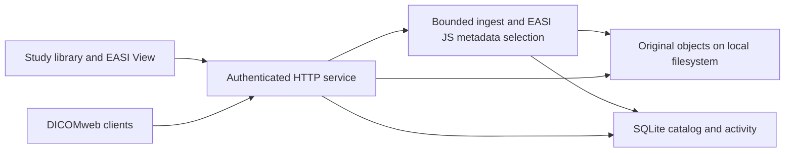

# Architecture

EASI Store is a modular monolith: one Node.js 24 service serves the management UI, authenticated APIs, DICOMweb, and local archive. EASI JS parses streaming DICOM input. EASI View renders supported images in the browser through its public SDK. These remain independent packages and assets.

The same process includes a local DIMSE Verification/Storage SCP. Its C-STORE acknowledgment follows the same durable ingest path as HTTP. It initially listens on AE `EASISTORE`, port 4248; Query/Retrieve and TLS are not implemented in this preview.

## Data boundary

The importer streams an instance into a bounded staging file, hashes the original bytes, and extracts selected indexing attributes without decoding pixel data. An accepted original is stored under an opaque path. Catalog commit and success response follow durable object persistence. A journal/reconciliation step handles interruptions across the filesystem/database boundary; those two resources do not share a transaction.

Identical SOP Instance UID and identical bytes is an idempotent duplicate. A different representation under an already stored SOP Instance UID is an explicit conflict in this first profile. The preview does not guess which representation should replace another. Future representation management must retain provenance and define safe normalization rules.

The hierarchy is patient → study → series → instance. Patient identity is scoped; it is not derived from a display name alone. Study/series/SOP UIDs remain protocol identifiers; storage paths do not use patient names or medical record numbers. The relational catalog stores indexed DICOM attributes and import outcomes, not pixel payloads.

## Interfaces

| Interface | Purpose |
| --- | --- |
| `/` | First-run setup, sign-in, library, and embedded viewer |
| `/api/health` | Minimal public service health |
| `/api/v1/session` | Minimal authentication/setup state |
| `/api/v1/setup`, `/login`, `/logout` | Local administration/session lifecycle |
| `/api/v1/summary` | Archive counts and stored bytes |
| `/api/v1/studies` | Management study search |
| `/api/v1/studies/{study}/series` | Series summaries |
| `/api/v1/studies/{study}/series/{series}/instances` | Instance summaries |
| `/api/v1/instances` | Raw `application/dicom` management import |
| `/api/v1/demo` | Generated synthetic demo import |
| `/api/v1/activity` | Persisted import outcomes |
| `/api/v1/capabilities` | Implemented protocol/profile capabilities |
| `/api/v1/download/{study}/{series}/{instance}` | Original DICOM download |
| `/dicomweb` | Initial standard-protocol profile; see DICOMweb guide |

All archive resources require authorization; the minimal health/session endpoints expose no catalog or patient information. The browser uses same-origin sessions. The management API does not imply compatibility with Orthanc's REST API.

## Storage evolution

The first adapter is SQLite plus a local filesystem, suited to a single-host archive with a single writer. Do not put a live SQLite WAL database on a network filesystem or share a data directory between containers. [SQLite's WAL documentation](https://www.sqlite.org/wal.html) explains that WAL requires a single host.

PostgreSQL and S3-compatible object storage are separate planned adapters. Introducing them requires object/catalog recovery, concurrent writers, integrity verification, migrations, and backup/restore qualification; swapping a connection string alone would not establish production readiness.

## Performance principles

- Bound encoded input and temporary storage; stream toward disk rather than buffering a study in RAM.
- Index metadata without pixel decode. Archive storage must not depend on the viewer's rendering support.
- Apply backpressure and define cancellation/shutdown behavior before introducing concurrency.
- Keep CPU-heavy transformations behind worker boundaries when they are added.
- Benchmark parser throughput, fsync cost, catalog updates, time to first image, and memory on realistic workloads before considering a language port.

The initial implementation deliberately reuses EASI JS. A future native component should solve a demonstrated bottleneck while preserving the storage and protocol contracts.
